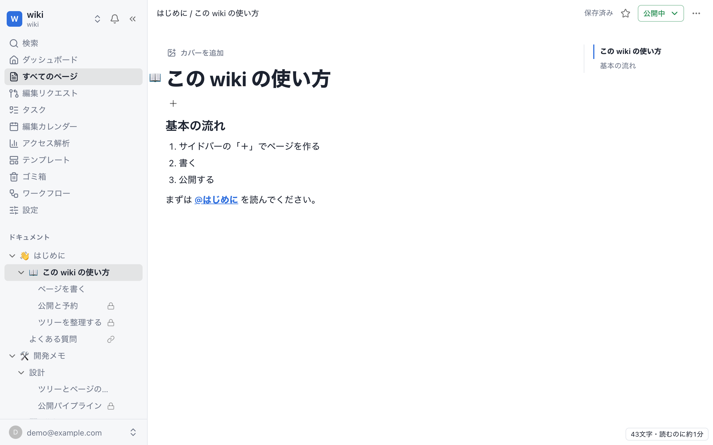
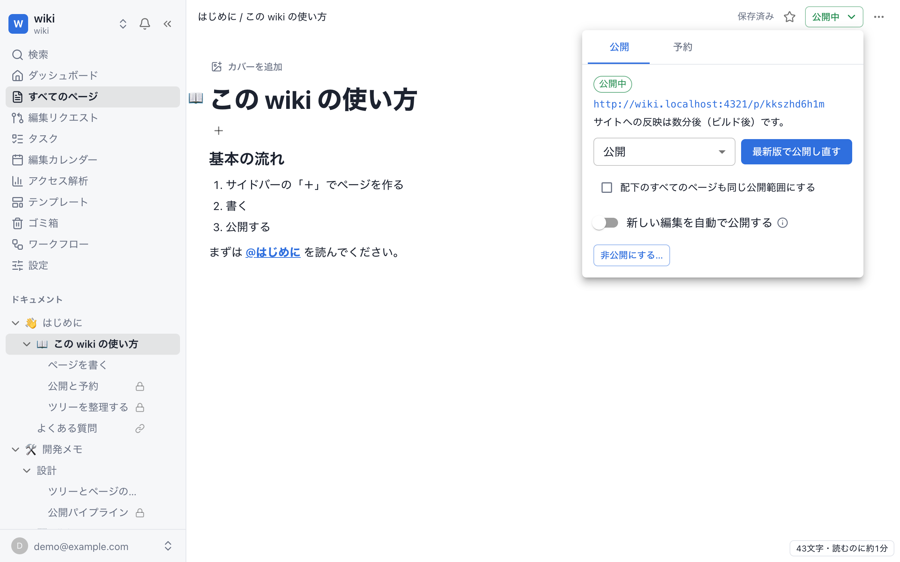
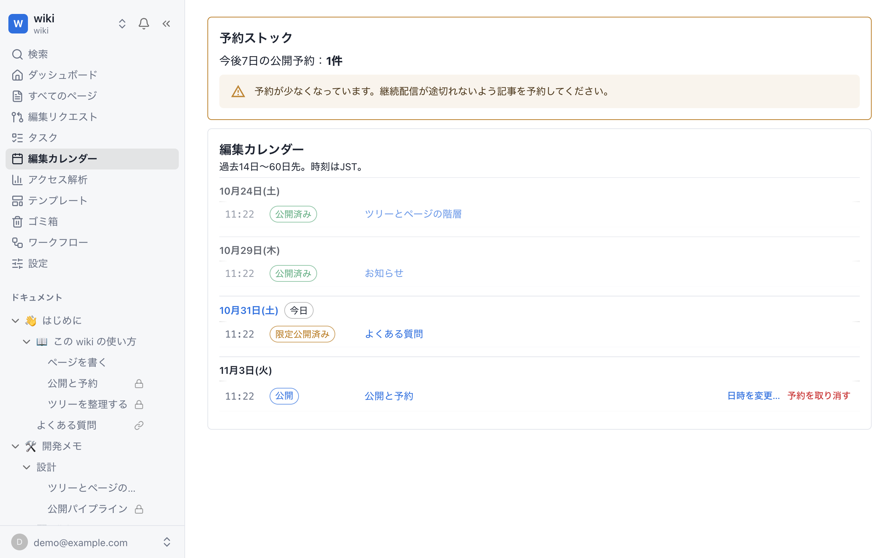
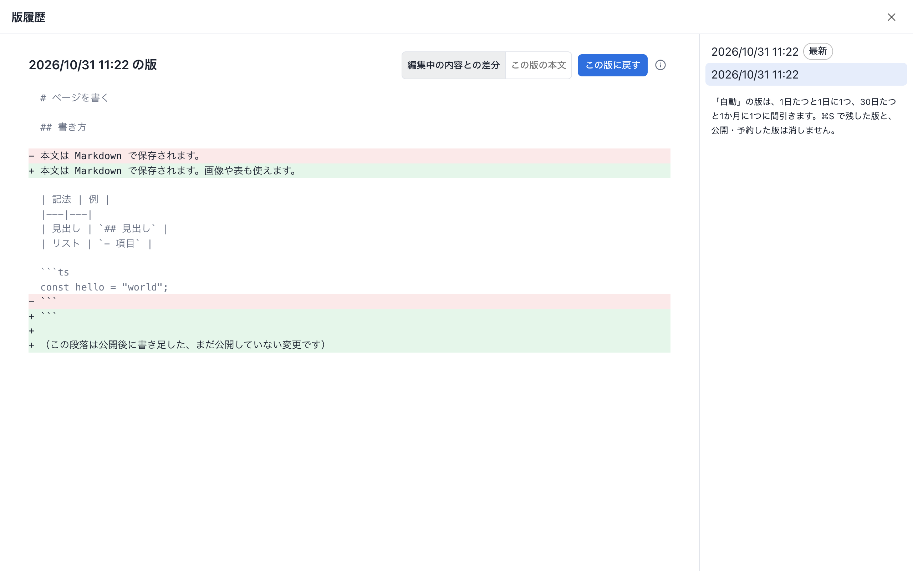
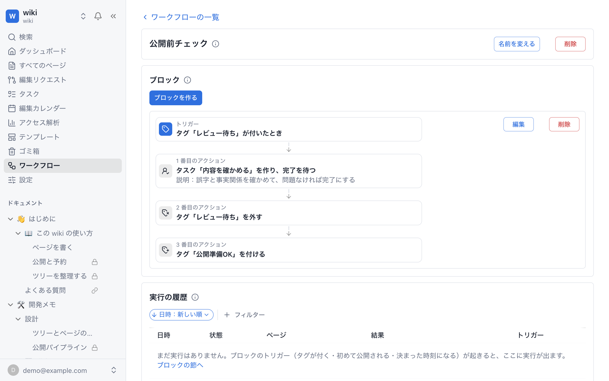
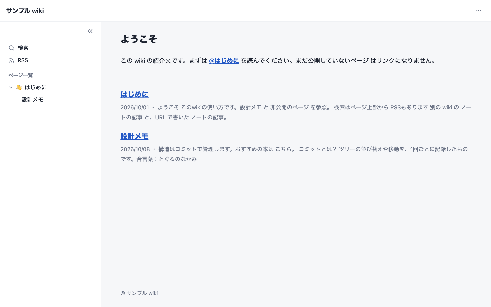
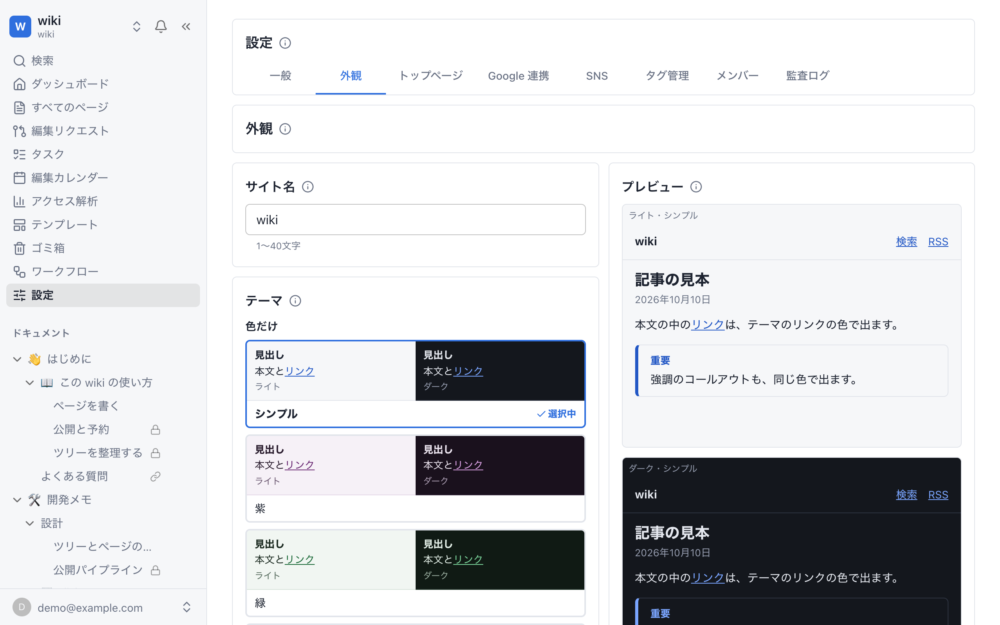
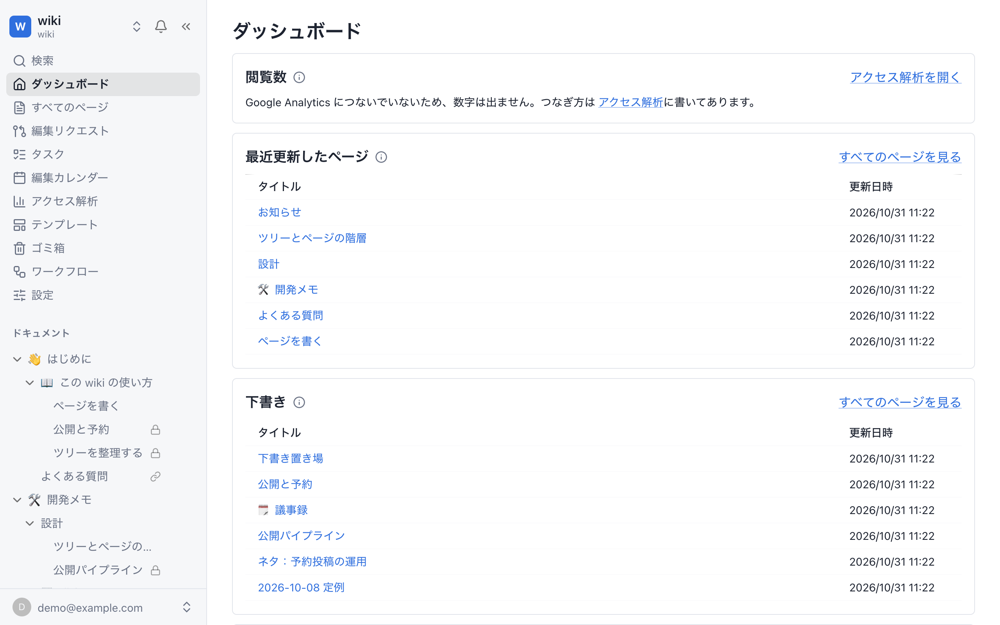

# wiki

書いたそばから流れていく公開型 wiki。ページを書いて公開や予約をし、ワークフローや AI エージェントに作業の一部を任せられる。wiki を複数持て、それぞれ別のサブドメインで公開できる。

使い方は[マニュアル](https://docs.hatchery-works.com/)に、構成・デプロイ・ローカル開発の手順は [docs/operations.md](docs/operations.md) にある。

## どうやって作ったか

AI を使って、2週間程度で作った。設計から実装、テストまでを [Claude Code](https://claude.com/claude-code) と進めていて、コミットの大半に Claude が関わっている。

## 画面

### 書く

ページをツリーで階層に並べて書く。打つのを止めると自動で保存する。

### 公開する

ページごとに、公開・限定公開・非公開を選べる。

### 予約する

公開と非公開化を予約でき、予定は編集カレンダーで見渡せる。

### 変更をたどる

過去の版との差分を見て、その版に戻せる。

### ワークフローに任せる

タグが付いたときなどをきっかけに、Claude の Routine の呼び出しや、人の作業の依頼を順に進める。

### 公開サイトを持つ

wiki ごとに公開サイトを持ち、検索や RSS も付く。

外観は管理画面で変えられる。

### 全体を見渡す

閲覧数、最近更新したページ、下書き、予約をダッシュボードで確かめられる。

